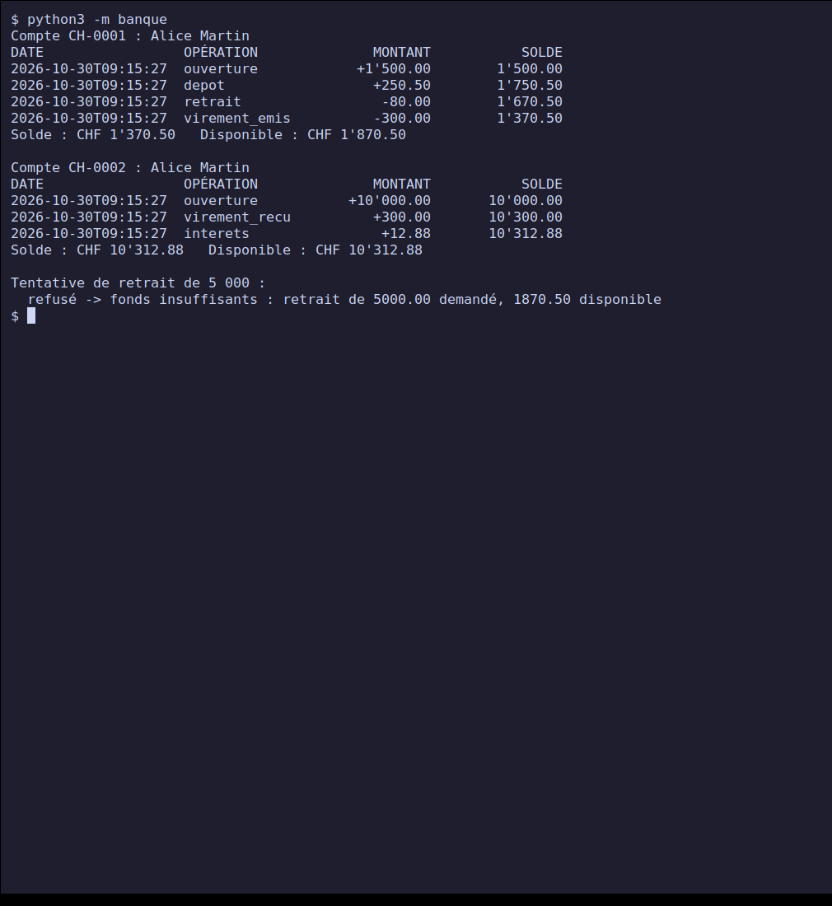
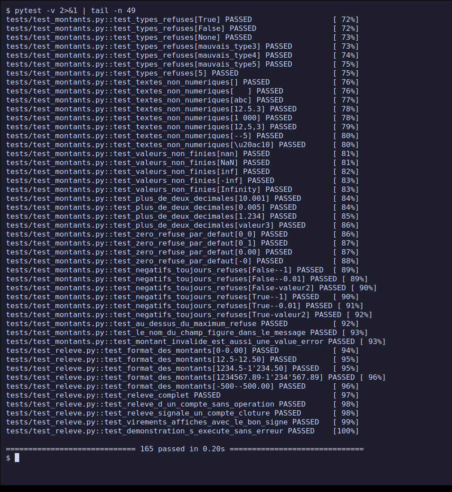
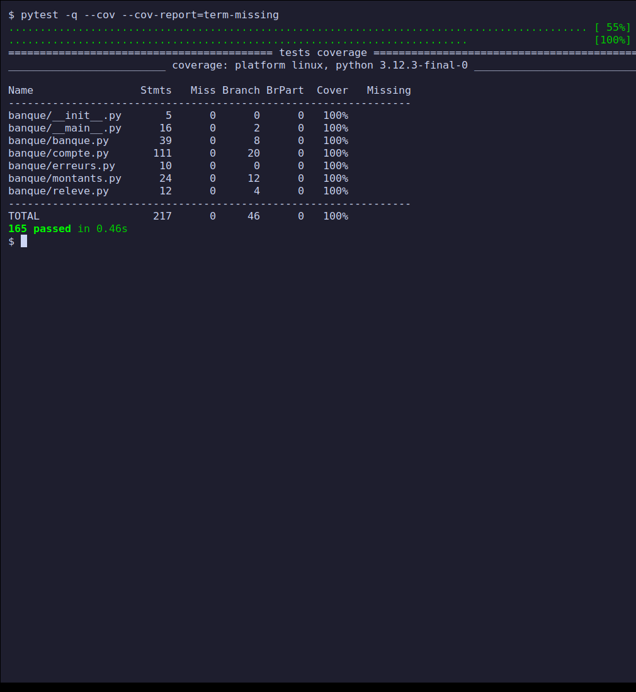
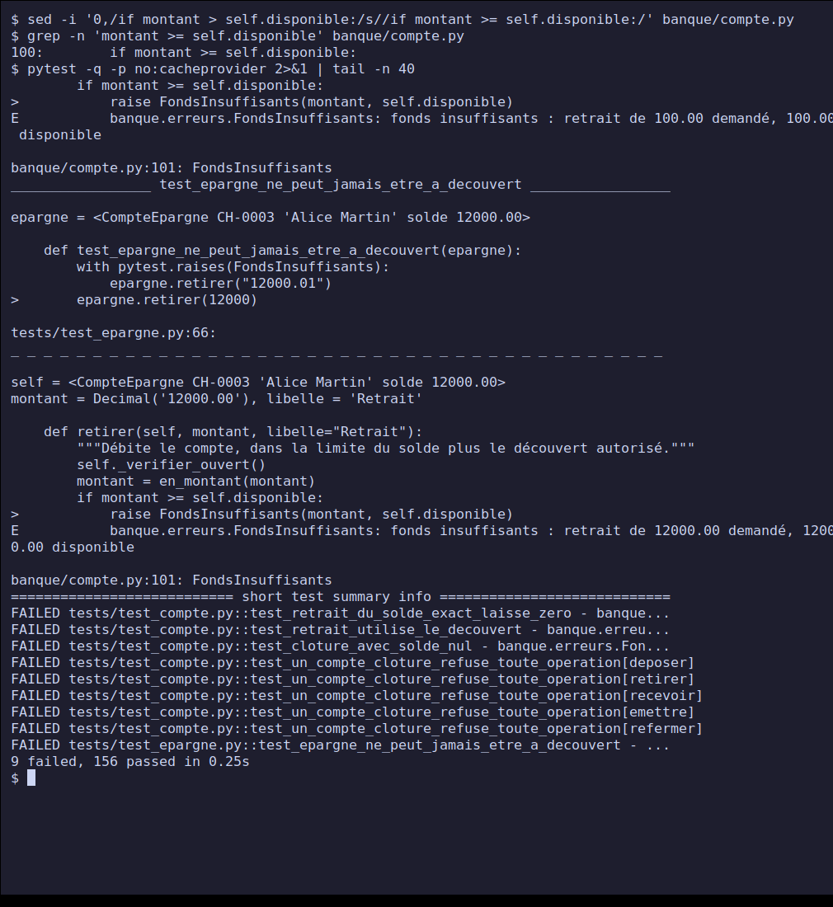
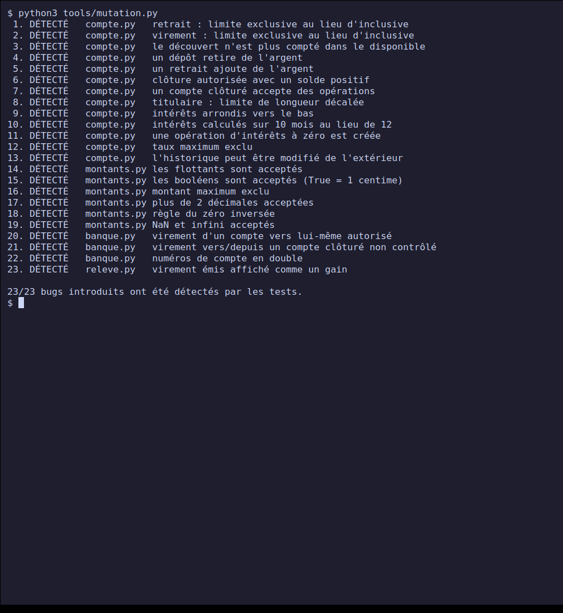

# PPE Python — Principes de base (classe E3)

**Journal et documentation des 5 projets de la semaine PPE** du cours *Python — Principes
de base*, avec les captures d'écran de chaque programme en fonctionnement.

Les cinq projets suivent les fiches du [dépôt du cours](https://github.com/Satom-IT-Learning-Solutions/E3/tree/main/02-python-principes-de-base)
(barème suisse, note sur 6, seuil de réussite 4.0). Chacun est livré avec son code, ses
tests automatisés, ses tests manuels documentés, sa notice et ses captures. Dernière mise à
jour : **30 octobre 2026**.

## Sommaire

- [Avancement](#avancement)
- [Jour 1 — Calculatrice et convertisseur d'unités](#jour-1--calculatrice-et-convertisseur-dunités)
- [Jour 2 — Gestionnaire de tâches en CLI](#jour-2--gestionnaire-de-tâches-en-cli)
- [Jour 3 — Analyse d'un fichier CSV de ventes](#jour-3--analyse-dun-fichier-csv-de-ventes)
- [Jour 4 — Client d'une API publique](#jour-4--client-dune-api-publique)
- [Jour 5 — Mini-application testée avec pytest](#jour-5--mini-application-testée-avec-pytest)
- [Bilan de la semaine](#bilan-de-la-semaine)
- [Reproduire les résultats](#reproduire-les-résultats)
- [Comment les captures ont été produites](#comment-les-captures-ont-été-produites)

## Avancement

Les « jours » numérotent les projets dans l'ordre de la fiche. Les dates indiquent quand
chacun a réellement été réalisé : plusieurs projets ont été menés le même jour.

| Jour | Projet | Niveau | Réalisé le | Tests auto. | Cas manuels | Captures | État |
| --- | --- | --- | --- | --- | --- | --- | --- |
| 1 | [Calculatrice et convertisseur](./projet-1-calculatrice-convertisseur/) | Débutant | 26 oct. | 20 | 28 | 6 | Terminé |
| 2 | [Gestionnaire de tâches en CLI](./projet-2-gestionnaire-taches-cli/) | Débutant / Intermédiaire | 28 oct. | 21 | 25 | 6 | Terminé |
| 3 | [Analyse d'un CSV de ventes](./projet-3-analyse-csv-ventes/) | Intermédiaire | 28 oct. | 29 | 21 | 6 | Terminé |
| 4 | [Client d'une API publique](./projet-4-client-api-publique/) | Intermédiaire / Avancé | 30 oct. | 24 | 22 | 5 | Terminé |
| 5 | [Mini-application testée avec pytest](./projet-5-mini-application-tests-pytest/) | Avancé | 30 oct. | 165 | : | 5 | Terminé |
| | **Total** | | | **259** | **96** | **28** | |

Tous les tests automatisés passent. Les projets 1 à 4 n'utilisent que la bibliothèque
standard de Python (plus `requests` pour le projet 4, que la fiche impose) ; le projet 5
a besoin de `pytest` et `pytest-cov`.

---

## Jour 1 — Calculatrice et convertisseur d'unités

**Projet :** [`projet-1-calculatrice-convertisseur/`](./projet-1-calculatrice-convertisseur/) ·
**Documentation complète :** [README](./projet-1-calculatrice-convertisseur/README.md),
[tests manuels](./projet-1-calculatrice-convertisseur/TESTS-MANUELS.md),
[notice](./projet-1-calculatrice-convertisseur/NOTICE.md)

Outil en ligne de commande à menu : six opérations (addition, soustraction, multiplication,
division, puissance, modulo) et trois convertisseurs (température, longueur, poids). Une
fonction par opération, une logique pure séparée du menu, et une saisie qui redemande tant
qu'elle est invalide.

**Points marquants**
- Logique et interface séparées : les fonctions ne lisent ni n'affichent rien, donc se
  testent seules. La fonction de saisie est un paramètre (`saisie=input`).
- Conversions par **unité pivot** : ajouter une unité = ajouter une ligne dans une table.
- Refus de `nan`, `inf`, `1e999` (Python les accepte comme des nombres valides) ; zéro
  absolu contrôlé pour les températures.
- **Résultats :** 20 tests automatisés, 28 cas manuels, tous conformes.

### Captures

**1. Menu principal**


**2. Calculs : addition, puis division par zéro refusée**


**3. Conversions : température, longueur, poids**


**4. Saisies invalides : choix de menu et nombres**


**5. Saisies invalides : unités et zéro absolu**


**6. Tests automatisés**


**Difficulté notable :** la première version du scénario de captures était désynchronisée
(une saisie en trop). Repérée en relisant l'image, corrigée, captures régénérées.

---

## Jour 2 — Gestionnaire de tâches en CLI

**Projet :** [`projet-2-gestionnaire-taches-cli/`](./projet-2-gestionnaire-taches-cli/) ·
**Documentation complète :** [README](./projet-2-gestionnaire-taches-cli/README.md),
[format du fichier](./projet-2-gestionnaire-taches-cli/FORMAT-FICHIER.md),
[tests manuels](./projet-2-gestionnaire-taches-cli/TESTS-MANUELS.md),
[notice](./projet-2-gestionnaire-taches-cli/NOTICE.md)

Gestionnaire de tâches (ajouter, lister avec filtres, terminer, supprimer) sauvegardé en
JSON : les tâches survivent à la fermeture du programme. Découpé en trois modules (modèle,
stockage, interface).

**Points marquants**
- Sauvegarde **atomique** (fichier temporaire puis renommage) : une coupure ne peut pas
  tronquer le fichier.
- Un fichier JSON **invalide n'est jamais écrasé** : le programme refuse de continuer, au
  lieu de repartir d'une liste vide et de détruire les données.
- Preuve de persistance par **deux terminaux distincts** (le premier est fermé avant le
  second).
- **Résultats :** 21 tests automatisés, 25 cas manuels, tous conformes.

### Captures

**1. Aide et ajout de tâches**


**2. Terminer, supprimer, filtrer, erreurs**


**3. Persistance, avant la fermeture** (liste et contenu JSON du fichier)


**4. Persistance, après redémarrage** (nouveau terminal : mêmes tâches retrouvées)


**5. Fichier corrompu refusé et jamais écrasé**


**6. Tests automatisés**


**Difficulté notable :** les captures utilisaient `clear; commande` sur une seule ligne, ce
qui effaçait la ligne de commande de l'image. Corrigé en deux frappes séparées. Limite
assumée : l'identifiant d'une dernière tâche supprimée est réattribué (documenté).

---

## Jour 3 — Analyse d'un fichier CSV de ventes

**Projet :** [`projet-3-analyse-csv-ventes/`](./projet-3-analyse-csv-ventes/) ·
**Documentation complète :** [README](./projet-3-analyse-csv-ventes/README.md),
[méthode de calcul](./projet-3-analyse-csv-ventes/METHODE.md),
[tests manuels](./projet-3-analyse-csv-ventes/TESTS-MANUELS.md),
[notice](./projet-3-analyse-csv-ventes/NOTICE.md),
[synthèse produite](./projet-3-analyse-csv-ventes/resultats/synthese.txt)

Lecture d'un export CSV de 320 ventes (jeu de données fictif, 3e trimestre 2026, généré avec
une graine fixe) et calcul de statistiques : chiffre d'affaires, moyenne par vente, produit
le plus vendu, regroupements par mois, région, catégorie et produit, filtres, tri et export
d'une synthèse. Module `csv`, sans pandas.

**Points marquants**
- Montants en `Decimal` : sommes **exactes**. Chiffre d'affaires : CHF 89'754.00.
- Une ligne invalide est **écartée et signalée** (numéro de ligne + raison) sans arrêter
  l'analyse.
- **Vérification croisée** : les indicateurs sont recalculés avec `awk`, sans le code
  Python ; résultats identiques au centime.
- **Résultats :** 29 tests automatisés, 21 cas manuels, tous conformes.

### Captures

**1. Aperçu du CSV et analyse complète**


**2. Filtres, tri et top** (août, région Vaud, produits triés par quantité)


**3. Lignes invalides écartées** (7 rejets sur 10 lignes, avec leur raison)


**4. Export de la synthèse**


**5. Vérification croisée avec `awk`**


**6. Tests automatisés**


**Difficulté notable :** le tri alphabétique plaçait « Écran » après « Souris » (les lettres
accentuées suivent `z` dans l'ordre des caractères). Trouvé par un test, corrigé par une clé
de tri sans accents ni casse.

---

## Jour 4 — Client d'une API publique

**Projet :** [`projet-4-client-api-publique/`](./projet-4-client-api-publique/) ·
**Documentation complète :** [README](./projet-4-client-api-publique/README.md),
[gestion des erreurs](./projet-4-client-api-publique/GESTION-ERREURS.md),
[tests manuels](./projet-4-client-api-publique/TESTS-MANUELS.md),
[notice](./projet-4-client-api-publique/NOTICE.md),
[exemples de sorties](./projet-4-client-api-publique/exemples/sortie-exemples.txt)

Client en ligne de commande de l'API publique **Frankfurter** (taux de change de la Banque
centrale européenne, sans clé) avec `requests` : conversion de montants, taux du jour ou
d'un jour passé, historique d'un taux avec minimum, maximum, moyenne et variation, liste des
devises. L'API a été choisie sans pouvoir consulter le formateur : à valider avec lui.

**Points marquants**
- Quatre types d'erreurs distincts (saisie, réseau, réponse HTTP en échec, réponse
  inutilisable) ; aucune trace Python n'est jamais affichée.
- **Nouvelles tentatives sélectives** avec attente croissante : réseau, délai dépassé, 429
  et 5xx sont rejoués ; les autres 4xx jamais.
- Un cours demandé un week-end est **signalé** : l'API répond avec le dernier jour ouvré.
- Tests contre un **serveur HTTP local factice** : le vrai code réseau est testé sans
  Internet. Les cas manuels, eux, ont été joués contre la vraie API.
- **Résultats :** 24 tests automatisés en 0,7 s, 22 cas manuels, tous conformes.

### Captures

Les taux affichés sont ceux du 29 octobre 2026.

**1. Aide et conversions**


**2. Taux, et cours d'un week-end**


**3. Historique sur un mois et liste des devises**


**4. Gestion des erreurs** (devise inconnue, saisies invalides, API injoignable avec 3 tentatives en 1,6 s)


**5. Tests automatisés**


**Difficulté notable :** `convertir 100 CHF CHF` donnait un `HTTP 422 : bad currency pair`
peu parlant. Refusé maintenant localement avec un message clair, et couvert par un test.

---

## Jour 5 — Mini-application testée avec pytest

**Projet :** [`projet-5-mini-application-tests-pytest/`](./projet-5-mini-application-tests-pytest/) ·
**Documentation complète :** [README](./projet-5-mini-application-tests-pytest/README.md),
[cas métier et règles](./projet-5-mini-application-tests-pytest/CAS-METIER.md),
[rapport d'exécution](./projet-5-mini-application-tests-pytest/rapport/)

Une **mini-banque** (comptes courants avec découvert, comptes épargne avec intérêts, virements
tout-ou-rien, relevés) et sa suite de tests pytest. Le cas métier est un choix personnel parmi
les exemples de la fiche, à valider avec le formateur. L'argent est un `Decimal`, jamais un
`float`.

**Points marquants**
- **165 tests** (77 fonctions, paramétrées) : cas nominaux, cas limites (valeur exacte de la
  frontière puis un centime au-delà), arrondis, entrées hostiles, atomicité des virements.
- Couverture de **100 % des lignes et des branches**.
- **Test de mutation** : 23 bugs introduits volontairement dans le code, 23 détectés par les
  tests. Une couverture à 100 % dit que le code s'exécute, pas que les tests vérifient quelque
  chose ; la mutation le contrôle.
- **Rapport d'exécution** exporté : sortie pytest, JUnit XML, couverture, mutation.

### Captures

**1. Démonstration de l'application**



**2. Les tests, un par ligne** (165 réussis)



**3. Couverture des lignes et des branches** (100 %)



**4. Un bug volontaire est détecté** (copie temporaire du code : 9 échecs)



**5. Test de mutation** (23 sur 23)



**Difficultés notables :** la configuration de `coverage` placée au mauvais endroit faisait
compter les fichiers de test (un « 100 % » trompeur) ; le test de mutation a révélé un
contrôle de type **redondant** dans le code (supprimé) ; un retour en arrière du virement
s'est avéré **inatteignable**, donc retiré.

---

## Bilan de la semaine

| Constat | Détail |
| --- | --- |
| Tout est vérifié, pas seulement affirmé | chaque chiffre des tableaux vient d'une exécution réelle ; les relevés manuels notent la sortie **observée** |
| Les tests ont trouvé de vrais défauts | tri alphabétique avec accents (jour 3), devise identique envoyée à l'API (jour 4), code redondant et code mort (jour 5) |
| Recoupements indépendants | `awk` contre le code Python (jour 3) ; test de mutation contre la suite de tests (jour 5) |
| Fil conducteur | séparer la logique des entrées/sorties pour pouvoir tester ; valider avant d'agir ; ne jamais écraser une donnée sur une erreur ; l'argent en `Decimal` |

**Limites à connaître**
- Les jeux de données (jour 3) sont fictifs ; l'API (jour 4) est réelle mais les taux changent.
- L'API du jour 4 et le cas métier du jour 5 sont à valider avec le formateur, comme le
  demandent les fiches.
- Les captures proviennent d'un terminal virtuel isolé, pas du bureau de la machine (voir
  ci-dessous). Les messages d'`argparse` (options invalides) restent en anglais.
- Tests et code ont été écrits par la même personne : une relecture croisée serait utile.

## Reproduire les résultats

Pré-requis : Python 3.8 ou plus récent (testé avec 3.12.3, Linux).

```bash
git clone https://github.com/bilkl/python-ppe-e3.git
cd python-ppe-e3

# Jours 1 à 3 : rien à installer
(cd projet-1-calculatrice-convertisseur && python3 -m unittest -v)
(cd projet-2-gestionnaire-taches-cli   && python3 -m unittest -v)
(cd projet-3-analyse-csv-ventes        && python3 -m unittest -v)

# Jour 4 : requests (les tests n'ont pas besoin d'Internet)
(cd projet-4-client-api-publique && python3 -m venv .venv && .venv/bin/pip install -r requirements.txt \
   && .venv/bin/python -m unittest -v)

# Jour 5 : pytest et pytest-cov
(cd projet-5-mini-application-tests-pytest && python3 -m venv .venv && .venv/bin/pip install -r requirements.txt \
   && .venv/bin/pytest --cov)
```

## Comment les captures ont été produites

Chaque projet contient un script `tools/capture.sh`. Il lance un écran virtuel isolé (Xvfb)
et un terminal (`xterm`), **tape réellement les commandes** (`xdotool`) puis capture l'écran
(`scrot`). Les programmes tournent donc pour de vrai ; aucune capture ne montre le bureau de
la machine. Le jour 4 interroge la vraie API : les taux changent d'une exécution à l'autre.
