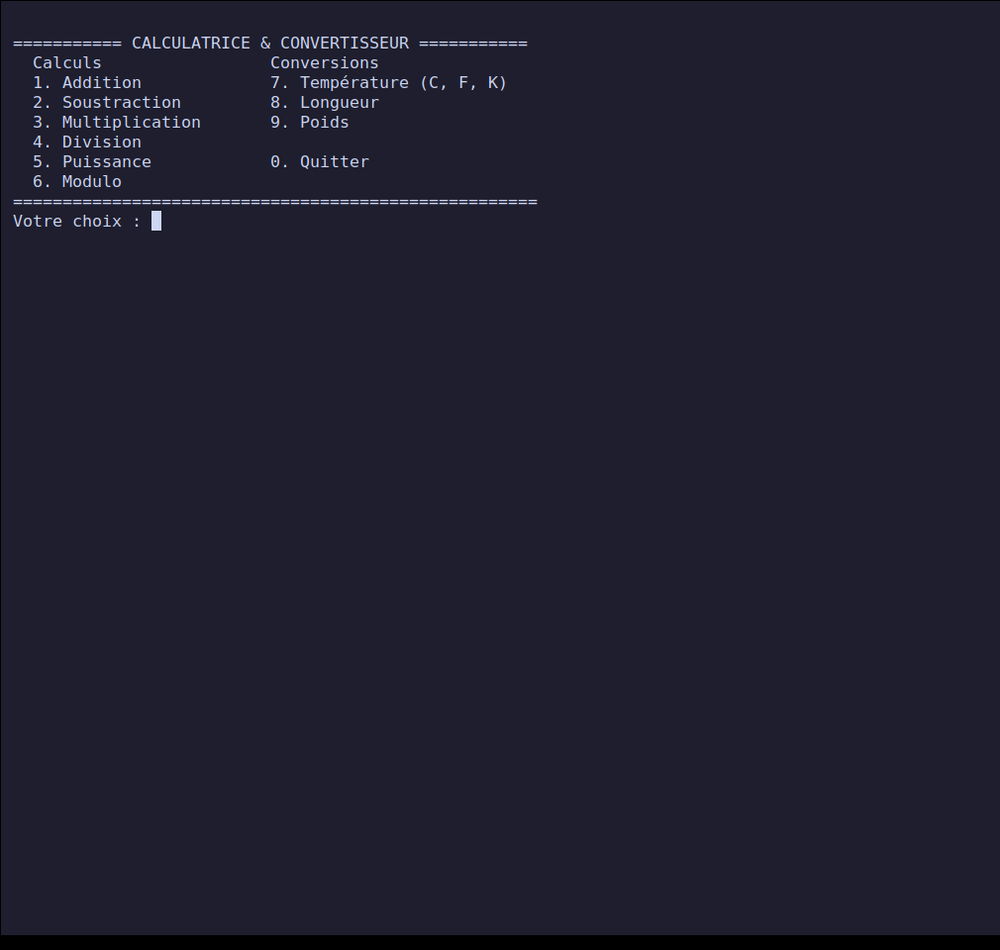
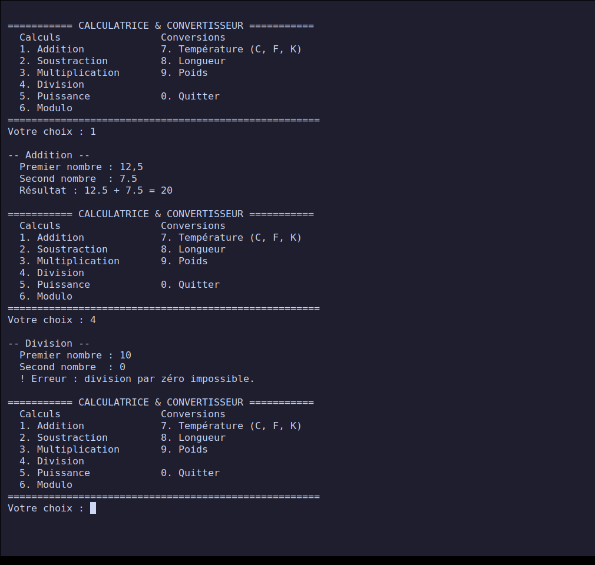
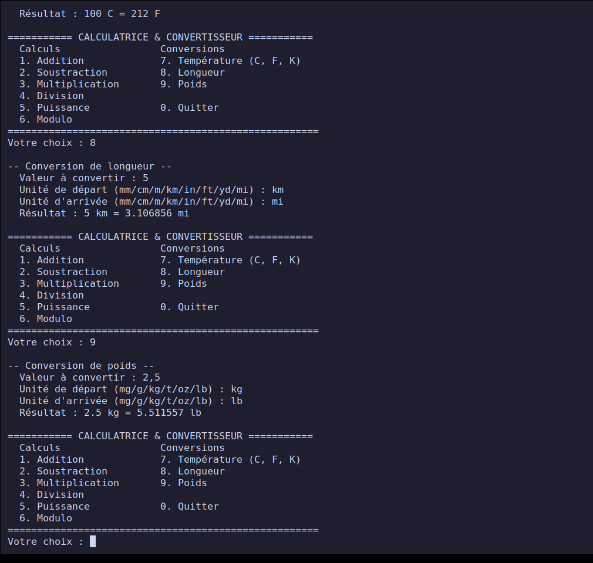
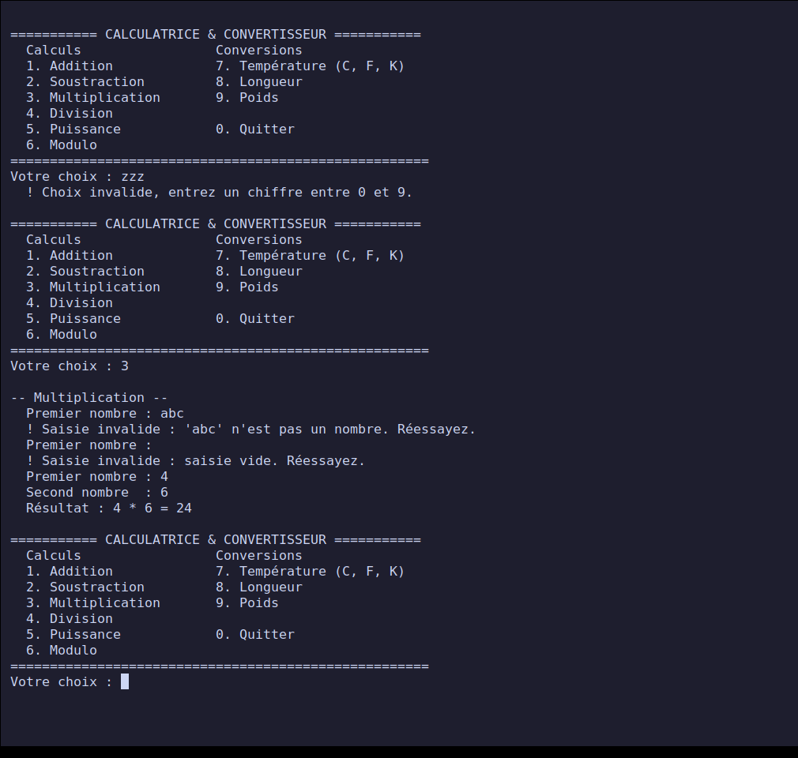
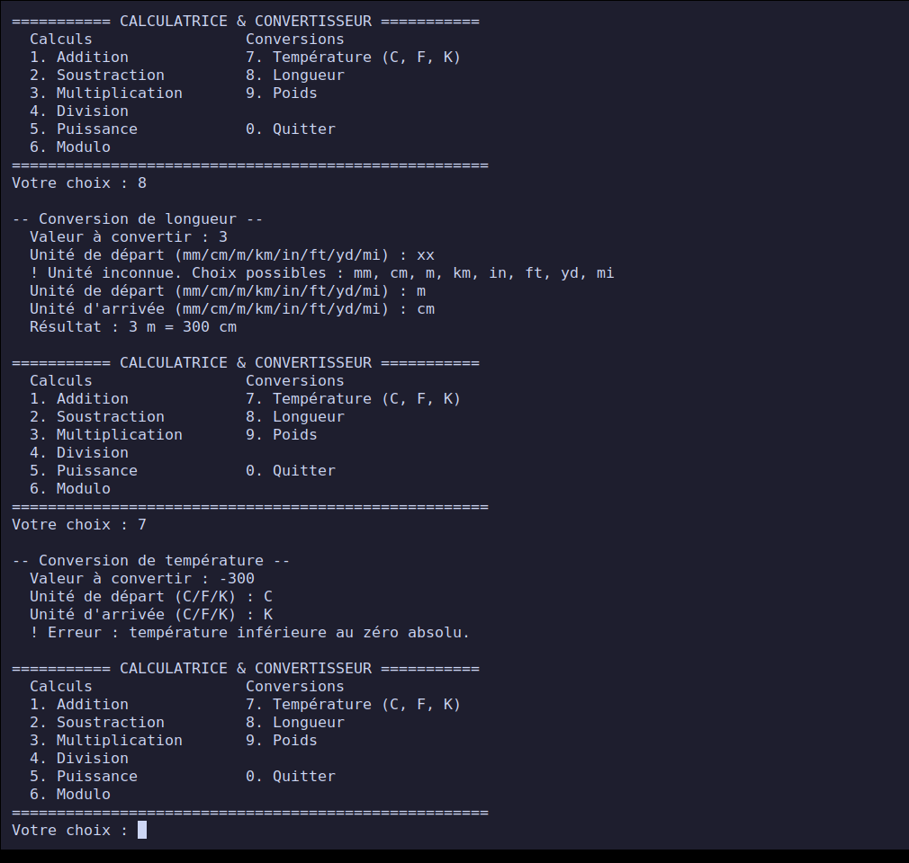
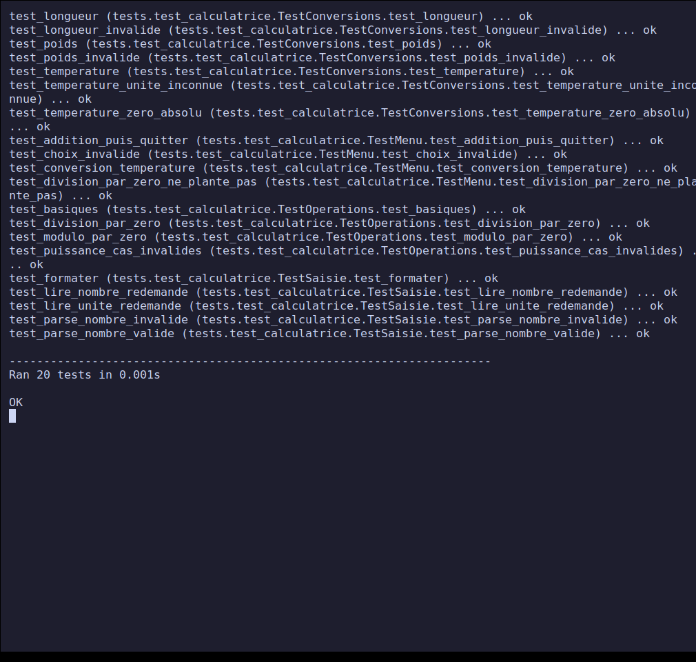

# Projet 1 — Calculatrice et convertisseur d'unités en ligne de commande

**Rendu PPE — Cours *Python — Principes de base* (classe E3).**
Réalisé le **26 octobre 2026**. Niveau : débutant.

Petit outil pédagogique en ligne de commande : six opérations de calcul et
trois convertisseurs d'unités (température, longueur, poids), avec une saisie
protégée contre les erreurs (texte, valeur vide, division par zéro, unité
inconnue, zéro absolu). Code en Python 3 standard, **sans aucune dépendance**.

## Sommaire

- [Avancement](#avancement)
- [Démarrage rapide](#démarrage-rapide)
- [Fonctionnalités](#fonctionnalités)
- [Structure du dépôt](#structure-du-dépôt)
- [Conception](#conception)
- [Captures d'écran](#captures-décran)
- [Tests et validation](#tests-et-validation)
- [Difficultés et décisions](#difficultés-et-décisions)
- [Correspondance avec la fiche du projet](#correspondance-avec-la-fiche-du-projet)
- [Sources](#sources)

## Avancement

| Étape de la fiche | État |
| --- | --- |
| 1. Définir les opérations et conversions | Terminé |
| 2. Une fonction par opération/conversion | Terminé |
| 3. Menu interactif en ligne de commande | Terminé |
| 4. Gestion des erreurs de saisie | Terminé |
| 5. Tests avec plusieurs scénarios, dont cas invalides | Terminé : 20 tests automatisés (OK) + 28 cas manuels documentés |
| Livrable : script Python commenté | [`calculatrice.py`](./calculatrice.py) |
| Livrable : jeu de tests manuels documenté | [`TESTS-MANUELS.md`](./TESTS-MANUELS.md) |
| Livrable : courte notice d'utilisation | [`NOTICE.md`](./NOTICE.md) |

## Démarrage rapide

Prérequis : Python 3.8 ou plus récent (testé avec Python 3.12.3 sous Linux).

```bash
git clone https://github.com/bilkl/python-ppe-e3.git
cd python-ppe-e3/projet-1-calculatrice-convertisseur
python3 calculatrice.py
```

Lancer les tests automatisés :

```bash
python3 -m unittest -v
```

## Fonctionnalités

| Menu | Fonction | Détail |
| --- | --- | --- |
| 1 | Addition | `a + b` |
| 2 | Soustraction | `a - b` |
| 3 | Multiplication | `a * b` |
| 4 | Division | refuse la division par zéro |
| 5 | Puissance | refuse `0` puissance négative, les résultats non réels et les dépassements |
| 6 | Modulo | refuse le modulo par zéro |
| 7 | Température | `C`, `F`, `K`, refuse les valeurs sous le zéro absolu |
| 8 | Longueur | `mm`, `cm`, `m`, `km`, `in`, `ft`, `yd`, `mi`, refuse les valeurs négatives |
| 9 | Poids | `mg`, `g`, `kg`, `t`, `oz`, `lb`, refuse les valeurs négatives |
| 0 | Quitter | |

La virgule décimale (`2,5`) est acceptée comme le point (`2.5`). Les unités ne
sont pas sensibles à la casse (`KM` = `km`).

## Structure du dépôt

```text
.
├── calculatrice.py            # le programme (logique + menu)
├── tests/
│   └── test_calculatrice.py   # 20 tests automatisés (unittest)
├── tools/
│   └── capture.sh             # génère les captures d'écran
├── screenshots/               # captures utilisées ci-dessous
├── TESTS-MANUELS.md           # jeu de tests manuels (entrées / sorties)
├── NOTICE.md                  # notice d'utilisation
└── README.md
```

## Conception

Le code sépare deux couches :

1. **Logique pure** : une fonction par opération (`addition`, `division`, ...)
   et par conversion (`convertir_temperature`, `convertir_longueur`,
   `convertir_poids`). Elles reçoivent des paramètres, renvoient une valeur et
   signalent un problème par `ValueError`. Aucune ne lit le clavier ni
   n'affiche quoi que ce soit, ce qui les rend testables seules.
2. **Interface** : `parse_nombre`, `lire_nombre` et `lire_unite` valident la
   saisie et redemandent tant qu'elle est invalide ; `main` affiche le menu et
   appelle la bonne fonction. La fonction de saisie est un paramètre
   (`saisie=input`), ce qui permet de simuler un utilisateur dans les tests.

Les conversions de longueur et de poids utilisent **une unité pivot** (mètre,
kilogramme) : une table de facteurs suffit, et ajouter une unité revient à
ajouter une ligne. La température passe par le Celsius.

## Captures d'écran

Les captures montrent le **vrai programme** exécuté dans un terminal. Elles sont
produites par [`tools/capture.sh`](./tools/capture.sh) : écran virtuel isolé
(Xvfb), terminal xterm, touches envoyées par `xdotool`, capture par `scrot`.
Le script est fourni, les captures sont donc reproductibles.

### 1. Menu principal



### 2. Calculs : addition, puis division par zéro refusée

Entrée : `1` → `12,5` → `7.5` (virgule et point acceptés), puis `4` → `10` → `0`.



### 3. Conversions : température, longueur, poids

`100 C = 212 F`, `5 km = 3.106856 mi`, `2.5 kg = 5.511557 lb`.



### 4. Saisies invalides : choix de menu et nombres

Un choix de menu `zzz`, puis dans la multiplication un nombre `abc` et une
saisie vide sont refusés et redemandés ; le programme ne plante pas.



### 5. Saisies invalides : unités et zéro absolu

Unité `xx` refusée avec la liste des choix ; `-300 C` en Kelvin refusé car
inférieur au zéro absolu.



### 6. Tests automatisés

20 tests, tous réussis.



## Tests et validation

| Type | Contenu | Résultat |
| --- | --- | --- |
| Automatisés (`unittest`) | opérations, conversions, cas limites, saisie, menu complet | 20/20 OK |
| Manuels documentés | 28 cas avec entrées, résultat attendu et résultat observé | voir [`TESTS-MANUELS.md`](./TESTS-MANUELS.md) |
| Captures d'écran | 6 captures du programme réel | ci-dessus |

Les cas invalides couverts : choix de menu hors liste, texte à la place d'un
nombre, saisie vide, `nan` / `inf` / dépassement (`1e999`), division et modulo
par zéro, `0` puissance négative, racine d'un négatif, unité inconnue, valeur
négative pour une longueur ou un poids, température sous le zéro absolu, fin de
saisie (`Ctrl+D`) et interruption (`Ctrl+C`).

## Difficultés et décisions

- **Pas de pytest.** Le module `unittest` fait partie de la bibliothèque
  standard : le projet n'a donc aucune dépendance à installer. (`pytest` est
  l'objet du projet 5.)
- **Nombres flottants.** `0.1 + 0.2` vaut `0.30000000000000004` en binaire.
  L'affichage est arrondi à 6 décimales sans zéros inutiles (`formater`), ce
  qui affiche `0.3`. Les tests de conversion comparent avec `assertAlmostEqual`.
- **`nan`, `inf` et `1e999`.** `float("nan")` est accepté par Python comme un
  nombre valide ; il aurait produit des résultats absurdes. `parse_nombre`
  refuse tout ce qui n'est pas fini.
- **Zéro absolu.** Contrôlé en Celsius après conversion vers l'unité pivot, ce
  qui couvre `K` négatif et `C` / `F` trop bas avec une seule règle.
- **Captures dans un écran virtuel** plutôt que sur le bureau : elles ne
  montrent que le terminal du programme, pas d'autres fenêtres. La première
  version du scénario 4 était désynchronisée (une saisie en trop) : repérée en
  relisant la capture, scénario corrigé et captures régénérées.
- **Découverte des tests.** Sans fichier `tests/__init__.py`, `python3 -m unittest`
  répond « NO TESTS RAN » : le dossier n'est pas exploré. Le fichier vide a été
  ajouté (constaté à l'exécution, puis corrigé).

## Correspondance avec la fiche du projet

| Critère d'évaluation | Pondération | Où le trouver |
| --- | --- | --- |
| Réalisation technique | 30 % | [`calculatrice.py`](./calculatrice.py), section [Conception](#conception) |
| Respect des consignes | 25 % | tableau d'[avancement](#avancement) : les 5 étapes et les 3 livrables |
| Tests / validation | 25 % | [`TESTS-MANUELS.md`](./TESTS-MANUELS.md), [`tests/`](./tests/), captures |
| Documentation | 20 % | ce README, [`NOTICE.md`](./NOTICE.md), docstrings du code |

## Sources

- Fiche du projet : [Satom-IT-Learning-Solutions/E3 — Projet 1](https://github.com/Satom-IT-Learning-Solutions/E3/blob/main/02-python-principes-de-base/projet-1-calculatrice-convertisseur.md)
- [Python — Tutoriel officiel](https://docs.python.org/3/tutorial/)
- [Python — Gestion des exceptions](https://docs.python.org/3/tutorial/errors.html)
- [Python — `unittest`](https://docs.python.org/3/library/unittest.html)
