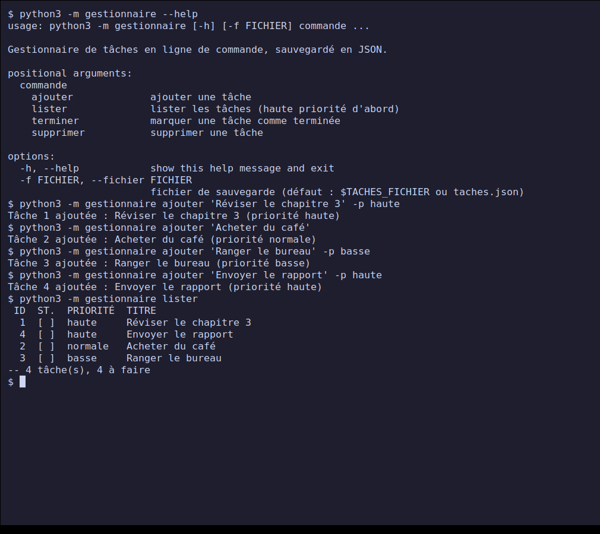
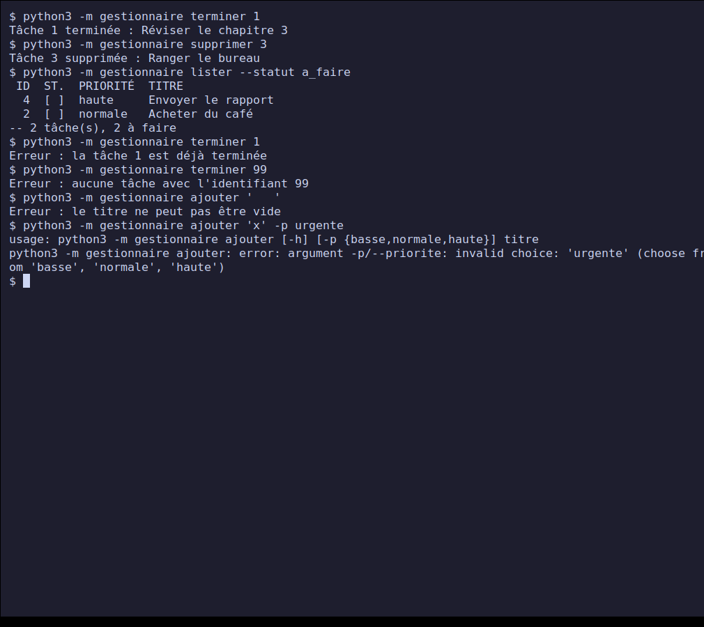
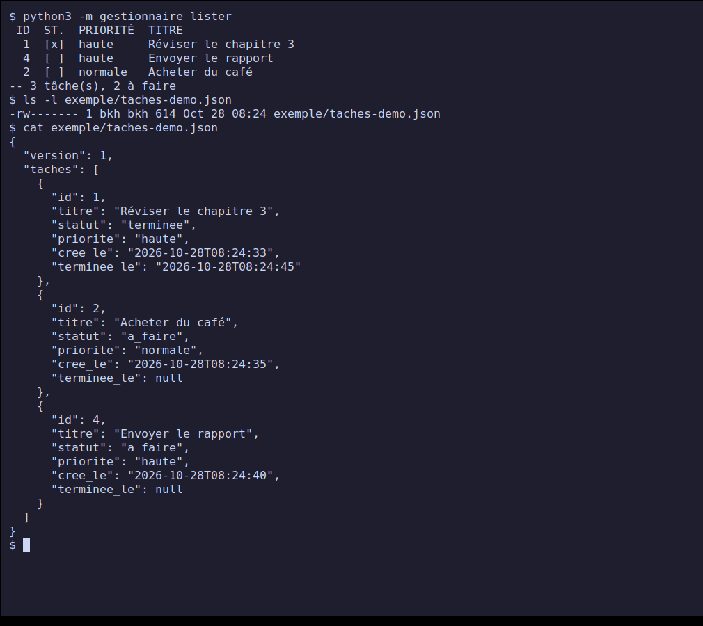
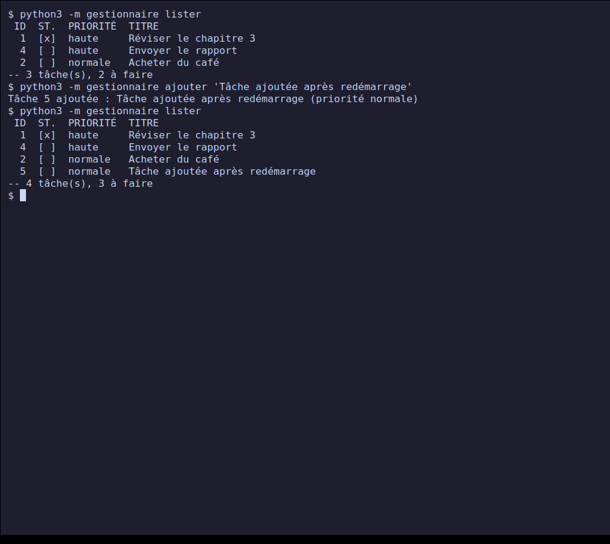
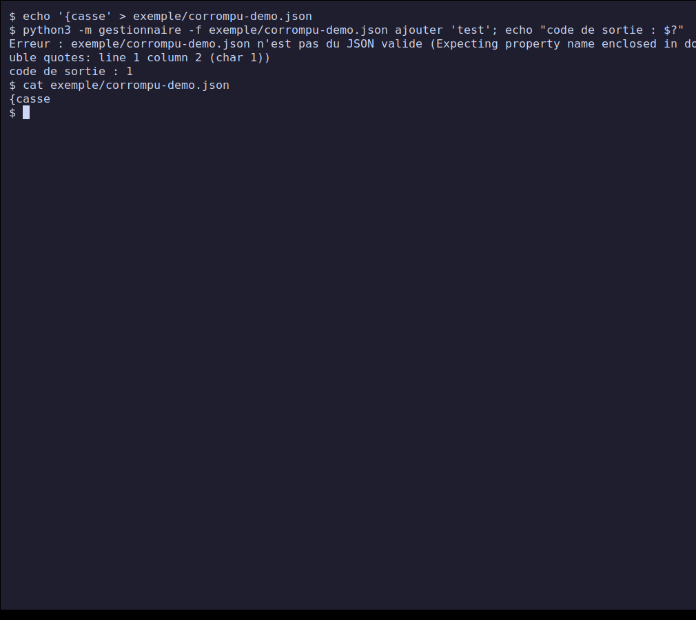
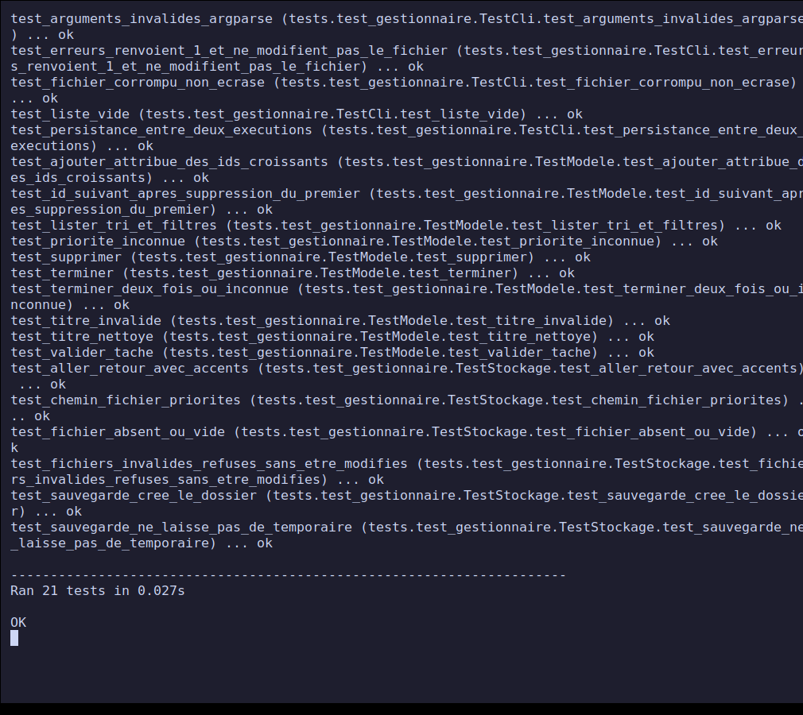

# Projet 2 — Gestionnaire de tâches en ligne de commande

**Rendu PPE — Cours *Python — Principes de base* (classe E3).**
Réalisé le **28 octobre 2026**. Niveau : débutant / intermédiaire.

Outil en ligne de commande pour suivre une liste de tâches (ajouter, lister, terminer,
supprimer) **sans service en ligne**. Les tâches sont sauvegardées dans un fichier JSON
à chaque modification et rechargées au démarrage : elles survivent à la fermeture du
programme. Python 3 standard, **aucune dépendance**.

## Sommaire

- [Avancement](#avancement)
- [Démarrage rapide](#démarrage-rapide)
- [Structure du dépôt](#structure-du-dépôt)
- [Conception](#conception)
- [Captures d'écran](#captures-décran)
- [Tests et validation](#tests-et-validation)
- [Difficultés et décisions](#difficultés-et-décisions)
- [Correspondance avec la fiche du projet](#correspondance-avec-la-fiche-du-projet)
- [Sources](#sources)

## Avancement

| Étape de la fiche | État |
| --- | --- |
| 1. Modéliser une tâche (titre, statut, priorité) en dictionnaire | Terminé : [`modele.py`](./gestionnaire/modele.py) |
| 2. Opérations : ajouter, lister, terminer, supprimer | Terminé (en plus : filtres de la liste) |
| 3. Sauvegarde dans un fichier à chaque modification | Terminé : [`stockage.py`](./gestionnaire/stockage.py), écriture atomique |
| 4. Chargement des tâches au démarrage | Terminé, avec validation du fichier |
| 5. Test de la persistance après fermeture et réouverture | Terminé : captures [03](#3-persistance-avant-la-fermeture) et [04](#4-persistance-après-redémarrage) |
| Livrable : code source | [`gestionnaire/`](./gestionnaire/) |
| Livrable : format de sauvegarde documenté | [`FORMAT-FICHIER.md`](./FORMAT-FICHIER.md) |
| Livrable : preuve de persistance (avant / après redémarrage) | captures 03 et 04, fichier [`exemple/taches-demo.json`](./exemple/taches-demo.json) |

## Démarrage rapide

Prérequis : Python 3.8 ou plus récent (testé avec Python 3.12.3 sous Linux).

```bash
git clone https://github.com/bilkl/python-ppe-e3.git
cd python-ppe-e3/projet-2-gestionnaire-taches-cli

python3 -m gestionnaire ajouter "Réviser le chapitre 3" -p haute
python3 -m gestionnaire ajouter "Acheter du café"
python3 -m gestionnaire lister
python3 -m gestionnaire terminer 1
python3 -m gestionnaire supprimer 2
```

Toutes les options sont décrites dans [`NOTICE.md`](./NOTICE.md). Lancer les tests :

```bash
python3 -m unittest -v
```

## Structure du dépôt

```text
.
├── gestionnaire/
│   ├── __main__.py      # point d'entrée : python3 -m gestionnaire
│   ├── cli.py           # interface : arguments, affichage, codes de sortie
│   ├── modele.py        # logique métier : la tâche et ses opérations (sans entrée/sortie)
│   └── stockage.py      # lecture / écriture / validation du fichier JSON
├── tests/test_gestionnaire.py   # 21 tests automatisés (unittest)
├── tools/capture.sh             # génère les captures d'écran
├── exemple/taches-demo.json     # fichier produit par le scénario de capture
├── screenshots/                 # captures utilisées ci-dessous
├── FORMAT-FICHIER.md            # format de sauvegarde documenté
├── TESTS-MANUELS.md             # 25 cas manuels (commande, attendu, observé)
├── NOTICE.md                    # notice d'utilisation
└── README.md
```

## Conception

Le programme est découpé en **trois modules** aux rôles séparés :

| Module | Rôle | Ce qu'il ne fait pas |
| --- | --- | --- |
| `modele.py` | une tâche est un `dict`, la liste est une `list` de `dict` ; fonctions `ajouter`, `lister`, `terminer`, `supprimer`, `valider_tache` | aucun accès au disque, aucun `print` |
| `stockage.py` | `charger`, `sauvegarder`, choix du chemin du fichier | aucune règle métier sur les tâches |
| `cli.py` | arguments (`argparse`), affichage, conversion des erreurs en messages et codes de sortie | aucune manipulation directe du JSON |

Une tâche :

```python
{"id": 1, "titre": "Réviser le chapitre 3", "statut": "a_faire",
 "priorite": "haute", "cree_le": "2026-10-28T08:24:33", "terminee_le": None}
```

Choix de conception :

- **Une commande = une exécution.** Le programme charge le fichier, applique
  l'opération, sauvegarde, puis s'arrête. La persistance est donc ce qui permet
  d'enchaîner les commandes, et elle est testable directement.
- **Les erreurs métier sont des `ValueError`**, les erreurs de fichier des
  `ErreurStockage` ; `cli.main` les attrape et renvoie le code 1 avec un message
  sur la sortie d'erreur, jamais une trace Python.
- **Écriture atomique** (fichier temporaire puis `os.replace`) : une coupure
  pendant la sauvegarde ne peut pas tronquer le fichier.
- **Un fichier invalide n'est jamais écrasé.** Si le JSON est cassé ou mal formé,
  le programme s'arrête sans rien modifier, au lieu de repartir d'une liste vide
  et de détruire les données au prochain ajout.

## Captures d'écran

Les captures montrent le **vrai programme** : les commandes sont réellement tapées
dans un terminal (écran virtuel isolé Xvfb, `xterm`, `xdotool`, `scrot`). Le script
[`tools/capture.sh`](./tools/capture.sh) les régénère. Le fichier de démonstration
est choisi par la variable `TACHES_FICHIER` (non visible dans les captures).

### 1. Aide et ajout de tâches



Quatre tâches ajoutées avec des priorités différentes ; `lister` les affiche par
priorité décroissante (haute, normale, basse), puis par identifiant.

### 2. Terminer, supprimer, filtrer, erreurs



La tâche 1 est terminée, la 3 supprimée, `lister --statut a_faire` filtre. Quatre
erreurs ensuite : tâche déjà terminée, identifiant inconnu, titre vide, priorité
inconnue (message d'`argparse`, en anglais).

### 3. Persistance, avant la fermeture



État de la liste, taille et date du fichier, puis son contenu JSON complet. Le
terminal est ensuite **fermé** : le programme et sa mémoire disparaissent.

### 4. Persistance, après redémarrage



Dans un **nouveau terminal**, `lister` retrouve exactement les mêmes trois tâches
(dont la tâche 1 terminée). Un ajout reçoit l'id 5, la suite logique de la
numérotation.

### 5. Fichier corrompu refusé et jamais écrasé



Sur un fichier contenant `{casse`, l'ajout est refusé (code de sortie 1) et le
`cat` montre que le fichier est resté intact.

### 6. Tests automatisés



## Tests et validation

| Type | Contenu | Résultat |
| --- | --- | --- |
| Automatisés (`unittest`) | modèle (ids, titres, priorités, tri, filtres), stockage (aller-retour avec accents, fichiers invalides, écriture atomique), CLI (persistance, erreurs, codes de sortie) | 21/21 OK, sans avertissement (`-W error`) |
| Manuels documentés | 25 cas : commande, attendu, observé, code de sortie | 25/25 conformes, voir [`TESTS-MANUELS.md`](./TESTS-MANUELS.md) |
| Preuve de persistance | captures 03 et 04 + test automatisé `test_persistance_entre_deux_executions` | conforme |

## Difficultés et décisions

- **Capture de la persistance.** Montrer « avant / après redémarrage » demande deux
  terminaux distincts. Le script en ouvre un, le ferme, puis en ouvre un second. Une
  première version tapait `clear; commande` sur une seule ligne, ce qui effaçait la
  ligne de commande de la capture ; corrigé en deux frappes séparées.
- **Identifiants.** Calculés comme « plus grand id + 1 ». Simple et sans compteur à
  sauvegarder, mais l'id d'une dernière tâche supprimée est réattribué. Constaté dans
  le cas manuel 9 et documenté dans les [limites](./FORMAT-FICHIER.md#limites-connues),
  plutôt que d'ajouter un compteur persistant hors du périmètre d'une fiche débutant.
- **Pas de verrou de fichier.** Deux exécutions simultanées peuvent s'écraser ;
  accepté pour un outil mono-utilisateur, noté dans les limites.
- **Messages d'`argparse` en anglais** (`invalid choice`, `required`). Les messages
  métier sont en français ; la traduction de ceux d'`argparse` n'a pas été faite.
- **Fichier en lecture seule.** Le renommage atomique remplace le fichier même s'il est
  en lecture seule, dans un dossier modifiable : constaté lors d'un essai, noté dans
  les limites.
- **Pas de `pytest`**, `unittest` suffit et évite toute dépendance (`pytest` est
  l'objet du projet 5).

## Correspondance avec la fiche du projet

| Critère d'évaluation | Pondération | Où le trouver |
| --- | --- | --- |
| Réalisation technique | 30 % | [`gestionnaire/`](./gestionnaire/), section [Conception](#conception) |
| Respect des consignes | 25 % | tableau d'[avancement](#avancement) : 5 étapes et 3 livrables |
| Tests / validation | 25 % | [`TESTS-MANUELS.md`](./TESTS-MANUELS.md), [`tests/`](./tests/), captures 03 à 06 |
| Documentation | 20 % | ce README, [`FORMAT-FICHIER.md`](./FORMAT-FICHIER.md), [`NOTICE.md`](./NOTICE.md), docstrings |

## Sources

- Fiche du projet : [Satom-IT-Learning-Solutions/E3 — Projet 2](https://github.com/Satom-IT-Learning-Solutions/E3/blob/main/02-python-principes-de-base/projet-2-gestionnaire-taches-cli.md)
- [Python — Manipulation de fichiers](https://docs.python.org/3/tutorial/inputoutput.html)
- [Python — Module json](https://docs.python.org/3/library/json.html)
- [Python — `argparse`](https://docs.python.org/3/library/argparse.html)
- [Python — `os.replace`](https://docs.python.org/3/library/os.html#os.replace)
