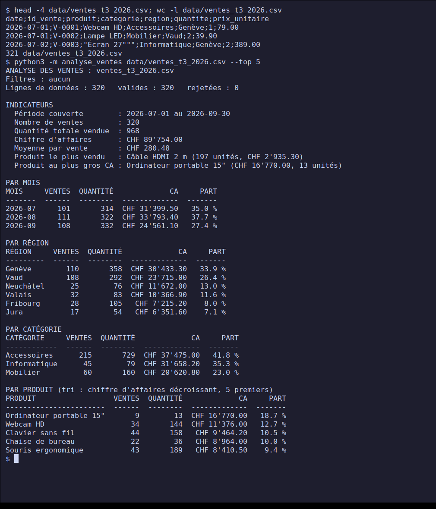
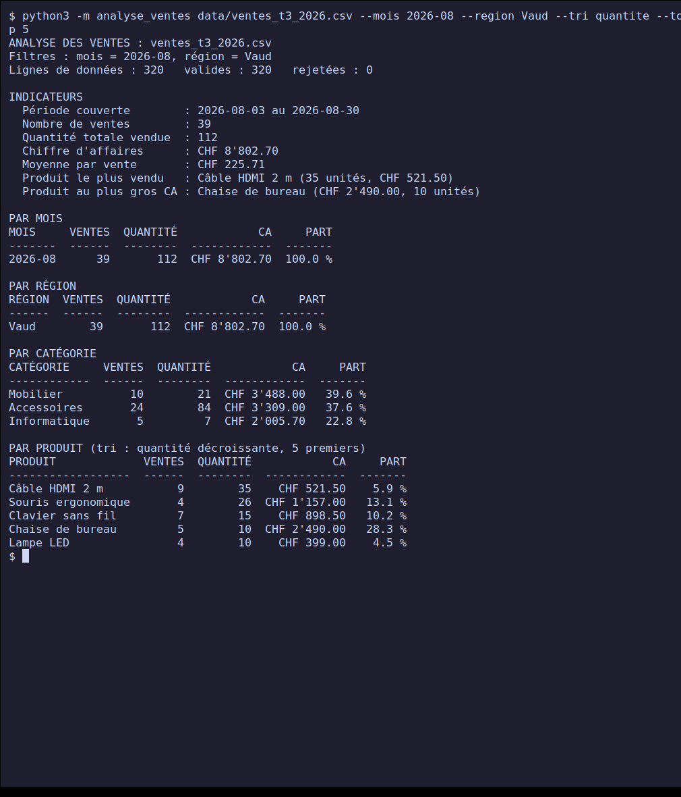
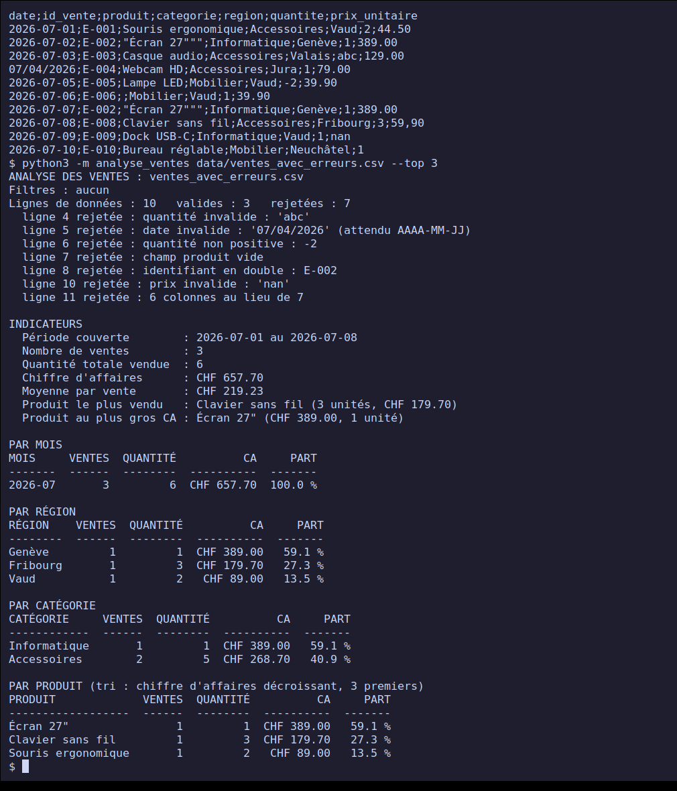
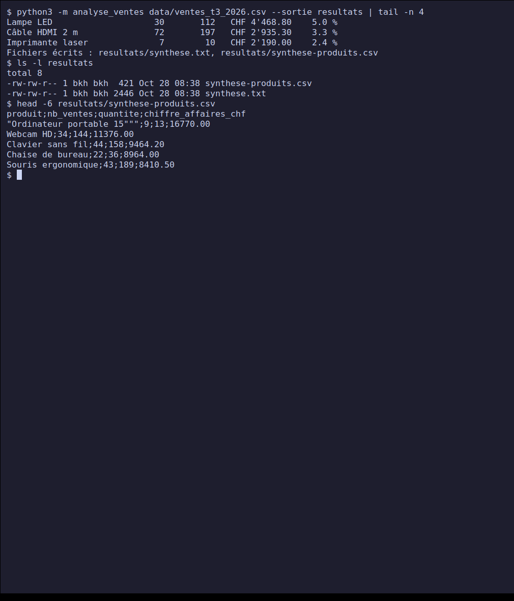
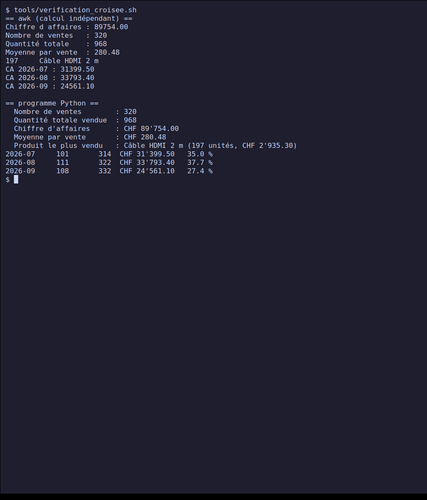
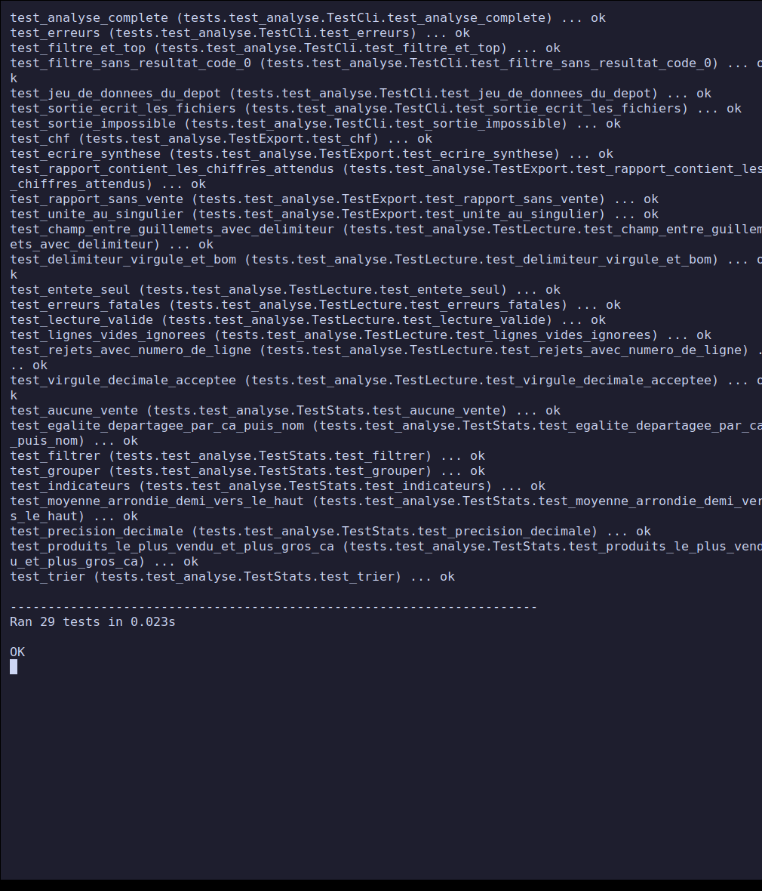

# Projet 3 — Analyse d'un fichier CSV de ventes

**Rendu PPE — Cours *Python — Principes de base* (classe E3).**
Réalisé le **28 octobre 2026**. Niveau : intermédiaire.

Outil en ligne de commande qui lit l'export CSV des ventes d'un trimestre et en tire
des statistiques sans ouvrir Excel : chiffre d'affaires, moyenne par vente, produit le
plus vendu, regroupements par mois, région, catégorie et produit, filtres, tri et export
d'une synthèse. Python 3 standard (module `csv`), **sans pandas ni autre dépendance**.

## Sommaire

- [Avancement](#avancement)
- [Démarrage rapide](#démarrage-rapide)
- [Structure du dépôt](#structure-du-dépôt)
- [Les données](#les-données)
- [Conception](#conception)
- [Captures d'écran](#captures-décran)
- [Tests et validation](#tests-et-validation)
- [Difficultés et décisions](#difficultés-et-décisions)
- [Correspondance avec la fiche du projet](#correspondance-avec-la-fiche-du-projet)
- [Sources](#sources)

## Avancement

| Étape de la fiche | État |
| --- | --- |
| 1. Récupérer ou générer un jeu de données CSV de ventes réaliste | Terminé : 320 ventes sur le 3e trimestre 2026, [générées](./tools/generer_donnees.py) avec une graine fixe |
| 2. Lire le fichier avec le module `csv` | Terminé : [`lecture.py`](./analyse_ventes/lecture.py), pandas non utilisé |
| 3. CA total, moyenne par vente, produit le plus vendu | Terminé : [`stats.py`](./analyse_ventes/stats.py) |
| 4. Trier et filtrer selon un critère (mois, région) | Terminé : filtres mois, région, catégorie ; tris `ca`, `quantite`, `nom` ; `--top` |
| 5. Exporter une synthèse claire | Terminé : rapport texte et CSV, [`resultats/`](./resultats/) |
| Livrable : script d'analyse commenté | [`analyse_ventes/`](./analyse_ventes/) |
| Livrable : fichier de synthèse produit | [`resultats/synthese.txt`](./resultats/synthese.txt) et [`resultats/synthese-produits.csv`](./resultats/synthese-produits.csv) |
| Livrable : note expliquant la méthode de calcul | [`METHODE.md`](./METHODE.md) |

## Démarrage rapide

Prérequis : Python 3.8 ou plus récent (testé avec Python 3.12.3 sous Linux).

```bash
git clone https://github.com/bilkl/python-ppe-e3.git
cd python-ppe-e3/projet-3-analyse-csv-ventes

python3 -m analyse_ventes data/ventes_t3_2026.csv
python3 -m analyse_ventes data/ventes_t3_2026.csv --mois 2026-08 --region Vaud --tri quantite --top 5
python3 -m analyse_ventes data/ventes_t3_2026.csv --sortie resultats
```

Toutes les options sont dans [`NOTICE.md`](./NOTICE.md). Lancer les tests :

```bash
python3 -m unittest -v
```

## Structure du dépôt

```text
.
├── analyse_ventes/
│   ├── __main__.py     # point d'entrée : python3 -m analyse_ventes
│   ├── cli.py          # arguments et orchestration
│   ├── lecture.py      # lecture du CSV, validation ligne par ligne, rejets
│   ├── stats.py        # calculs (Decimal) : CA, moyenne, regroupements, tri, filtres
│   └── export.py       # mise en forme du rapport, écriture de la synthèse
├── data/
│   ├── ventes_t3_2026.csv       # 320 ventes valides (fictives)
│   └── ventes_avec_erreurs.csv  # 10 lignes dont 7 invalides
├── resultats/                   # synthèse produite sur le jeu complet
├── tests/test_analyse.py        # 29 tests automatisés (unittest)
├── tools/
│   ├── generer_donnees.py       # génère les deux CSV (reproductible)
│   ├── verification_croisee.sh  # recalcul indépendant avec awk
│   └── capture.sh               # génère les captures d'écran
├── screenshots/
├── METHODE.md          # méthode de calcul (livrable)
├── TESTS-MANUELS.md    # 21 cas manuels, recoupés avec awk
├── NOTICE.md           # notice d'utilisation
└── README.md
```

## Les données

Les données sont **fictives** : un export de PME de matériel de bureau, du 1er juillet au
30 septembre 2026, 12 produits dans 3 catégories (informatique, accessoires, mobilier),
6 régions romandes. Le générateur applique des poids de popularité, vend les articles
chers à l'unité et les petits par lots, et réduit l'activité le week-end. Il est
déterministe (graine fixée) : le même fichier est reproduit à chaque exécution.

```text
date;id_vente;produit;categorie;region;quantite;prix_unitaire
2026-07-01;V-0001;Webcam HD;Accessoires;Genève;1;79.00
```

Un second fichier, `ventes_avec_erreurs.csv`, contient les défauts typiques d'un export
réel (quantité non numérique, date au mauvais format, quantité négative, champ vide,
identifiant en double, prix `nan`, colonne manquante, virgule décimale) pour tester la
robustesse.

## Conception

Quatre modules, une responsabilité chacun :

| Module | Rôle | Ce qu'il ne fait pas |
| --- | --- | --- |
| `lecture.py` | `lire_ventes` renvoie les ventes valides, les rejets (numéro de ligne + raison) et le nombre de lignes | aucun calcul statistique |
| `stats.py` | `chiffre_affaires`, `moyenne_par_vente`, `grouper`, `trier`, `filtrer`, `produit_le_plus_vendu` | aucune lecture de fichier, aucun affichage |
| `export.py` | rapport texte aligné, montants en CHF, écriture de `synthese.txt` et `synthese-produits.csv` | aucun calcul |
| `cli.py` | arguments `argparse`, enchaînement, codes de sortie | aucune logique métier |

Décisions de conception principales :

- **Une ligne invalide n'arrête pas l'analyse.** Elle est écartée et signalée (numéro,
  raison) ; seul un fichier inutilisable (absent, vide, mal encodé, colonnes manquantes)
  donne une erreur. Le rapport montre toujours combien de lignes ont été lues, gardées,
  rejetées.
- **`Decimal` pour l'argent**, pas `float` : les sommes sont exactes (voir
  [`METHODE.md`](./METHODE.md)).
- **Définitions explicites** : « plus vendu » = plus d'unités ; le produit au plus gros
  chiffre d'affaires est affiché à côté.
- **Résultats déterministes** : toute égalité de tri est départagée de façon fixe.

## Captures d'écran

Les captures montrent le **vrai programme** : commandes réellement tapées dans un
terminal (écran virtuel Xvfb, `xterm`, `xdotool`, `scrot`). [`tools/capture.sh`](./tools/capture.sh)
les régénère, ainsi que [`resultats/`](./resultats/).

### 1. Aperçu du CSV et analyse complète



Les 320 ventes : CA CHF 89'754.00, moyenne CHF 280.48. Le produit le plus vendu est le
câble HDMI (197 unités) mais le plus gros chiffre d'affaires vient de l'ordinateur
portable (13 unités seulement).

### 2. Filtres, tri et top



Août, région Vaud, produits triés par quantité, 5 premiers.

### 3. Lignes invalides écartées



Sur 10 lignes, 7 sont rejetées avec leur numéro et leur raison ; les 3 valides sont
analysées (dont la ligne au prix `59,90`, virgule décimale acceptée).

### 4. Export de la synthèse



### 5. Vérification croisée avec `awk`



`awk` recalcule les indicateurs sans le code Python : mêmes valeurs, au centime.

### 6. Tests automatisés



## Tests et validation

| Type | Contenu | Résultat |
| --- | --- | --- |
| Automatisés (`unittest`) | lecture (délimiteurs, BOM, guillemets, huit sortes de lignes rejetées, erreurs fatales), statistiques sur un jeu de 4 ventes calculé à la main, précision décimale, égalités, filtres, tri, export, CLI | 29/29 OK, sans avertissement (`-W error`) |
| Manuels documentés | 21 cas, recoupés avec `awk` quand c'est possible | 21/21 conformes, voir [`TESTS-MANUELS.md`](./TESTS-MANUELS.md) |
| Vérification croisée | recalcul indépendant en `awk` des indicateurs et du CA mensuel | identique au centime |

## Difficultés et décisions

- **Tri alphabétique et accents.** Le premier test de tri a échoué : Python classe
  « Écran » après « Souris », car les lettres accentuées viennent après `z` dans l'ordre
  des caractères. Corrigé avec une clé de tri sans accents ni casse (`cle_alpha`).
- **Un test mal écrit de ma part.** Un autre échec du même passage venait d'un décompte
  attendu faux dans le test (9 au lieu de 10 lignes de données), pas du programme ;
  corrigé dans le test.
- **Flottants.** Avec des `float`, les sommes de montants risquent des écarts d'arrondi ; avec
  `Decimal`, elles sont exactes et le recoupement `awk` tombe juste.
- **`1 unités`.** La première sortie affichait « 1 unités » : accord au singulier ajouté.
- **Lignes vides et séparateurs.** Les lignes vides (ou faites de séparateurs seuls)
  sont ignorées sans compter comme rejets, car elles se glissent souvent en fin de
  fichier dans les exports.
- **Données fictives.** Aucune donnée commerciale réelle n'est utilisée.
- **Messages d'`argparse`** (`invalid choice`, `required`) restent en anglais.
- **Pas de pandas** : le module `csv` suffit pour cette taille de fichier, et la
  fiche le propose en première option.

## Correspondance avec la fiche du projet

| Critère d'évaluation | Pondération | Où le trouver |
| --- | --- | --- |
| Réalisation technique | 30 % | [`analyse_ventes/`](./analyse_ventes/), section [Conception](#conception) |
| Respect des consignes | 25 % | tableau d'[avancement](#avancement) : 5 étapes et 3 livrables |
| Tests / validation | 25 % | [`TESTS-MANUELS.md`](./TESTS-MANUELS.md), [`tests/`](./tests/), captures 03 à 06 |
| Documentation | 20 % | ce README, [`METHODE.md`](./METHODE.md), [`NOTICE.md`](./NOTICE.md), docstrings |

## Sources

- Fiche du projet : [Satom-IT-Learning-Solutions/E3 — Projet 3](https://github.com/Satom-IT-Learning-Solutions/E3/blob/main/02-python-principes-de-base/projet-3-analyse-csv-ventes.md)
- [Python — Module csv](https://docs.python.org/3/library/csv.html)
- [Python — Module decimal](https://docs.python.org/3/library/decimal.html)
- [Python — Module unicodedata](https://docs.python.org/3/library/unicodedata.html)
