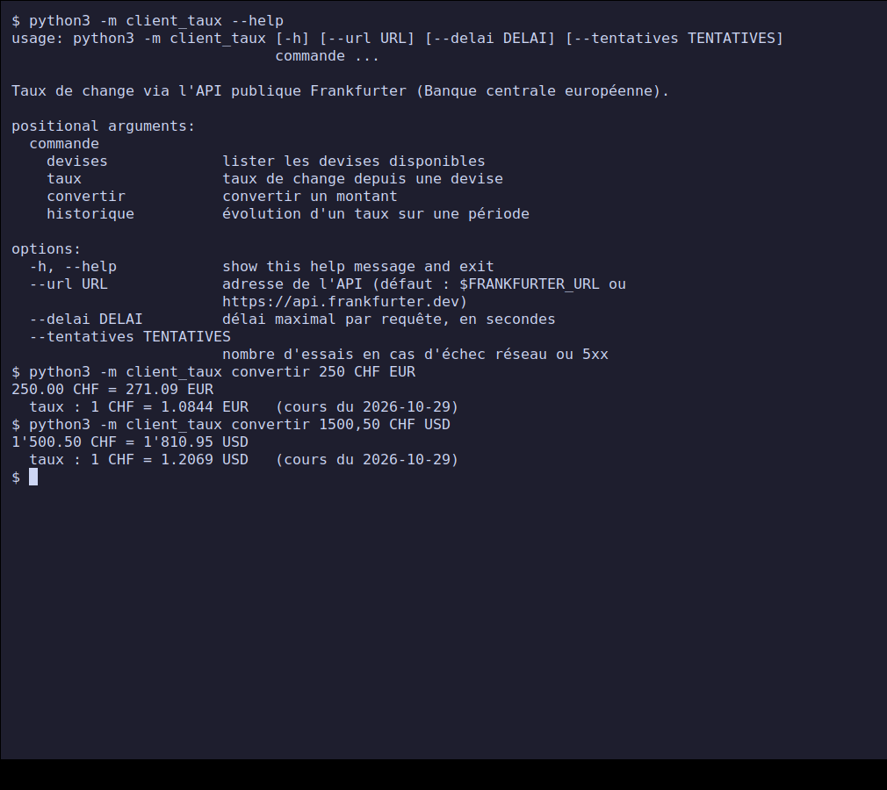
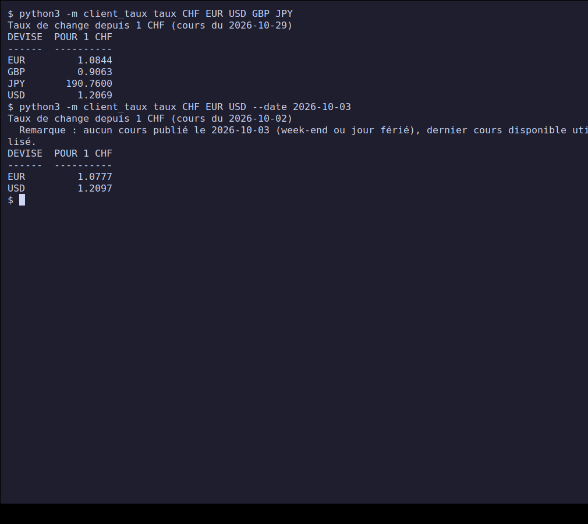
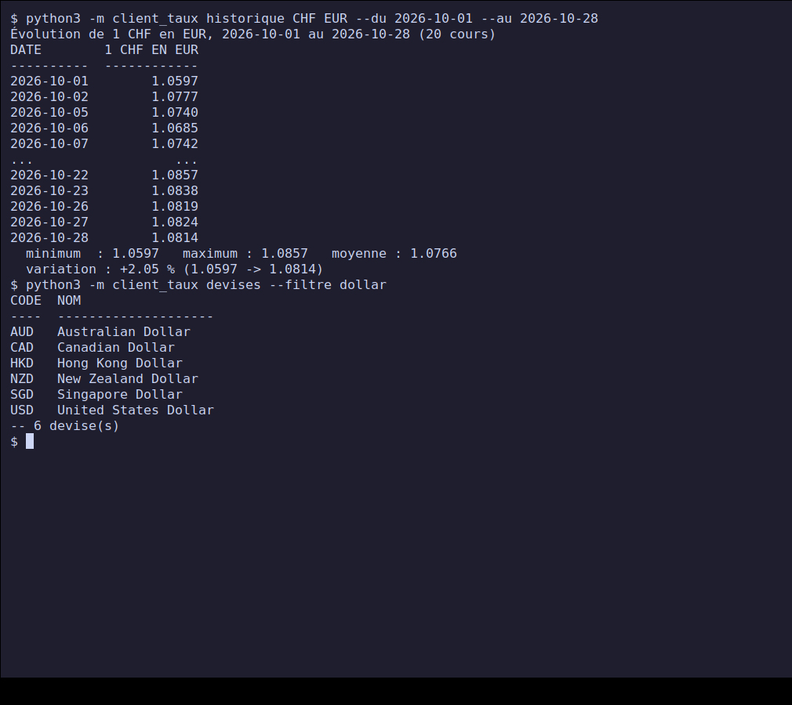
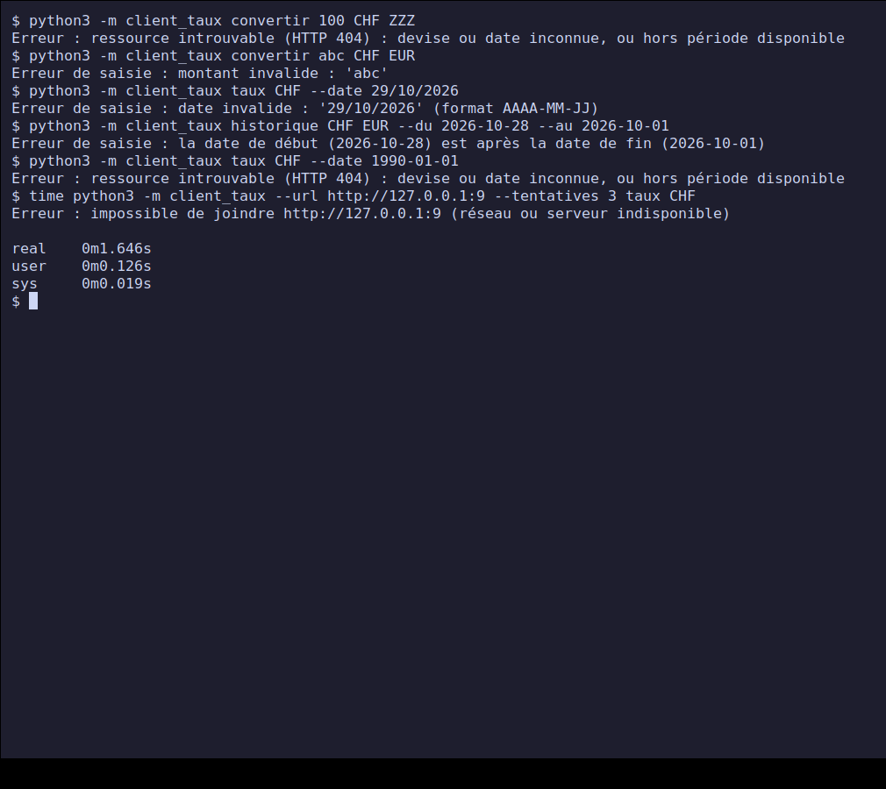
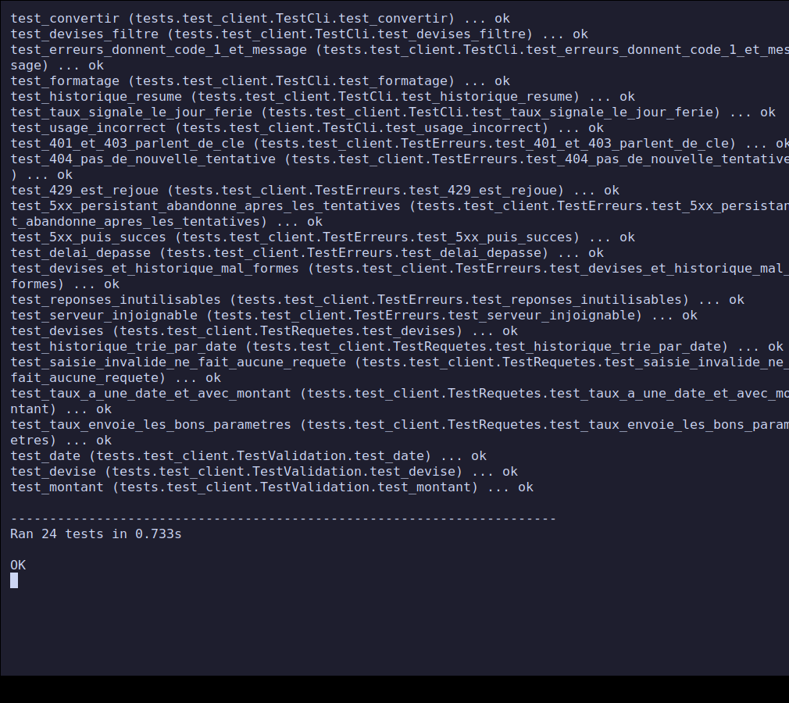

# Projet 4 — Client d'une API publique en Python

**Rendu PPE — Cours *Python — Principes de base* (classe E3).**
Réalisé le **30 octobre 2026**. Niveau : intermédiaire / avancé.

Client en ligne de commande de l'**API publique Frankfurter** (taux de change de la Banque
centrale européenne) : conversion de montants, taux du jour ou d'un jour passé, évolution
d'un taux sur une période, liste des devises. Requêtes HTTP avec la bibliothèque `requests`,
lecture de la réponse JSON, gestion soignée des erreurs réseau et des réponses invalides.

## Sommaire

- [Avancement](#avancement)
- [Démarrage rapide](#démarrage-rapide)
- [Structure du dépôt](#structure-du-dépôt)
- [Choix de l'API](#choix-de-lapi)
- [Conception](#conception)
- [Captures d'écran](#captures-décran)
- [Tests et validation](#tests-et-validation)
- [Difficultés et décisions](#difficultés-et-décisions)
- [Correspondance avec la fiche du projet](#correspondance-avec-la-fiche-du-projet)
- [Sources](#sources)

## Avancement

| Étape de la fiche | État |
| --- | --- |
| 1. Choisir une API publique gratuite adaptée | Terminé : Frankfurter, voir [Choix de l'API](#choix-de-lapi) |
| 2. Requête GET avec `requests` | Terminé : [`api.py`](./client_taux/api.py) |
| 3. Parser la réponse JSON et extraire les champs pertinents | Terminé, avec validation de chaque champ |
| 4. Gérer les erreurs (API indisponible, clé manquante, données absentes) | Terminé : [`GESTION-ERREURS.md`](./GESTION-ERREURS.md) |
| 5. Présenter les résultats de façon lisible en ligne de commande | Terminé : [`cli.py`](./client_taux/cli.py) |
| Livrable : script client de l'API | [`client_taux/`](./client_taux/) |
| Livrable : exemple de sortie pour au moins 3 requêtes différentes | 4 requêtes dans [`exemples/sortie-exemples.txt`](./exemples/sortie-exemples.txt) et captures 1 à 3 |
| Livrable : note sur la gestion des erreurs | [`GESTION-ERREURS.md`](./GESTION-ERREURS.md) |

## Démarrage rapide

Prérequis : Python 3.8 ou plus récent, accès Internet, bibliothèque `requests`
(testé avec Python 3.12.3 et `requests` 2.31.0 sous Linux).

```bash
git clone https://github.com/bilkl/python-ppe-e3.git
cd python-ppe-e3/projet-4-client-api-publique
python3 -m venv .venv && . .venv/bin/activate
pip install -r requirements.txt

python3 -m client_taux convertir 250 CHF EUR
python3 -m client_taux taux CHF EUR USD GBP
python3 -m client_taux historique CHF EUR --du 2026-10-01 --au 2026-10-28
python3 -m client_taux devises --filtre dollar
```

Détail des commandes : [`NOTICE.md`](./NOTICE.md). Tests (sans accès Internet) :

```bash
python3 -m unittest -v
```

## Structure du dépôt

```text
.
├── client_taux/
│   ├── __main__.py   # point d'entrée : python3 -m client_taux
│   ├── api.py        # requêtes (requests), validations, erreurs, nouvelles tentatives
│   └── cli.py        # commandes, mise en forme, codes de sortie
├── tests/
│   ├── serveur_factice.py   # petit serveur HTTP local qui simule l'API
│   └── test_client.py       # 24 tests automatisés (unittest)
├── tools/
│   ├── capture.sh    # captures d'écran (contre la vraie API)
│   └── exemples.sh   # enregistre des sorties réelles dans exemples/
├── exemples/sortie-exemples.txt
├── screenshots/
├── GESTION-ERREURS.md   # note sur la gestion des erreurs (livrable)
├── TESTS-MANUELS.md     # 22 cas manuels contre la vraie API
├── NOTICE.md
├── requirements.txt
└── README.md
```

## Choix de l'API

La fiche demande de choisir l'API « avec le formateur ». Faute de pouvoir le consulter,
j'ai retenu **Frankfurter** ([frankfurter.dev](https://frankfurter.dev)), à valider avec
lui. Critères : gratuite, sans compte ni clé, documentée, stable, et pertinente pour un
usage suisse (le franc suisse y est une devise de départ). Elle propose les deux familles
d'appels dont l'exercice a besoin : un point simple (`/v1/latest`) et un point avec dates
et séries (`/v1/AAAA-MM-JJ..AAAA-MM-JJ`).

| Appel du client | Requête HTTP |
| --- | --- |
| `devises` | `GET /v1/currencies` |
| `taux`, `convertir` | `GET /v1/latest?base=CHF&symbols=EUR,USD[&amount=250]` ou `GET /v1/AAAA-MM-JJ?...` |
| `historique` | `GET /v1/2026-10-01..2026-10-28?base=CHF&symbols=EUR` |

**Clé d'API.** Frankfurter n'en demande pas. Le cas « clé manquante » de la fiche est
tout de même géré (HTTP 401 / 403) et testé : voir [`GESTION-ERREURS.md`](./GESTION-ERREURS.md).

## Conception

| Module | Rôle | Ce qu'il ne fait pas |
| --- | --- | --- |
| `api.py` | classe `ClientTaux` : `devises()`, `taux()`, `historique()` ; validations ; conversion des échecs en trois erreurs distinctes ; nouvelles tentatives | aucun affichage |
| `cli.py` | arguments `argparse`, mise en forme des tableaux, codes de sortie | aucune requête directe, aucune validation du JSON |

Points de conception :

- **Valider avant d'envoyer.** Code de devise, date, montant et période sont contrôlés
  localement : une saisie invalide ne génère aucune requête.
- **Ne jamais faire confiance à la réponse.** Chaque champ utilisé est vérifié (présent,
  du bon type, nombre fini, pas un booléen). Une réponse incomplète donne une erreur claire,
  pas un `KeyError`.
- **Un délai sur chaque requête** (10 s par défaut) : sans lui, `requests` peut attendre
  indéfiniment.
- **Nouvelles tentatives sélectives** : réseau, délai dépassé, 429 et 5xx sont rejoués
  avec attente croissante ; les erreurs 4xx ne le sont jamais.
- **Client injectable** : `cli.main(argv, client=...)` et `ClientTaux(url, session=...)`
  permettent de tester sans Internet.

## Captures d'écran

Les captures montrent le **vrai programme contre la vraie API** : commandes réellement
tapées dans un terminal (écran virtuel Xvfb, `xterm`, `xdotool`, `scrot`). Les taux sont
ceux du 29 octobre 2026. [`tools/capture.sh`](./tools/capture.sh) les régénère (les taux
affichés changeront).

### 1. Aide et conversions



### 2. Taux, et cours d'un week-end



Pour le samedi 3 octobre, aucun cours n'est publié : le client utilise le vendredi 2
octobre et le dit.

### 3. Historique sur un mois et liste des devises



### 4. Gestion des erreurs



Devise inconnue (404), montant et dates invalides, période inversée, date trop ancienne,
puis API injoignable avec 3 tentatives : 1,6 s, soit les attentes de 0.5 s et 1 s.

### 5. Tests automatisés



## Tests et validation

| Type | Contenu | Résultat |
| --- | --- | --- |
| Automatisés (`unittest`) | validations, paramètres envoyés, 401 / 403 / 404 / 429 / 5xx, nouvelles tentatives et attentes, délai dépassé, serveur injoignable, huit formes de réponse inutilisable, commandes du CLI | 24/24 OK en 0,7 s, sans Internet, sans avertissement (`-W error`) |
| Manuels documentés | 22 cas contre la vraie API | 22/22 conformes, voir [`TESTS-MANUELS.md`](./TESTS-MANUELS.md) |
| Exemples de sortie | 4 requêtes différentes | [`exemples/sortie-exemples.txt`](./exemples/sortie-exemples.txt) |

Les tests automatisés lancent un **serveur HTTP local** qui rejoue chaque situation
d'erreur : le vrai code `requests` est exercé, mais rien ne dépend de l'API publique ni
des taux du jour.

## Difficultés et décisions

- **Tester les erreurs réseau.** On ne peut pas faire tomber la vraie API à la demande ;
  un serveur local factice (`http.server`) simule 500, 429, HTML, JSON incomplet et
  réponses lentes.
- **Tests trop lents au début** (13,8 s) : l'arrêt du serveur factice attendait jusqu'à
  0,5 s à chaque test. Réduit en abaissant l'intervalle de `serve_forever` : 0,7 s.
- **Week-ends.** L'API ne publie pas de cours le week-end et répond avec le dernier jour
  ouvré. Sans traitement, l'utilisateur croirait avoir le cours du jour demandé : la date
  réelle de la réponse est comparée à la date demandée et une remarque est affichée.
- **Même devise des deux côtés.** `convertir 100 CHF CHF` donnait `HTTP 422 : bad currency
  pair`. Refusé maintenant localement avec un message clair (trouvé pendant les essais
  manuels).
- **Montant converti.** Il vient de l'API (arrondi à 2 décimales) ; le taux affiché est
  recalculé, d'où `1.0844` pour un résultat calculé à partir de `1.08436...`.
- **Pas de clé d'API** avec Frankfurter : le cas est géré et testé quand même.
- **Messages d'`argparse`** (`invalid choice`, `required`) en anglais, non traduits.
- **Dépendance externe** : `requests` n'est pas dans la bibliothèque standard ; elle est
  déclarée dans `requirements.txt` (la fiche la demande explicitement).

## Correspondance avec la fiche du projet

| Critère d'évaluation | Pondération | Où le trouver |
| --- | --- | --- |
| Réalisation technique | 30 % | [`client_taux/`](./client_taux/), section [Conception](#conception) |
| Respect des consignes | 25 % | tableau d'[avancement](#avancement) : 5 étapes et 3 livrables |
| Tests / validation | 25 % | [`TESTS-MANUELS.md`](./TESTS-MANUELS.md), [`tests/`](./tests/), captures 4 et 5 |
| Documentation | 20 % | ce README, [`GESTION-ERREURS.md`](./GESTION-ERREURS.md), [`NOTICE.md`](./NOTICE.md) |

## Sources

- Fiche du projet : [Satom-IT-Learning-Solutions/E3 — Projet 4](https://github.com/Satom-IT-Learning-Solutions/E3/blob/main/02-python-principes-de-base/projet-4-client-api-publique.md)
- [Frankfurter — documentation de l'API](https://frankfurter.dev)
- [requests — documentation officielle](https://requests.readthedocs.io/en/latest/)
- [Python — Module json](https://docs.python.org/3/library/json.html)
